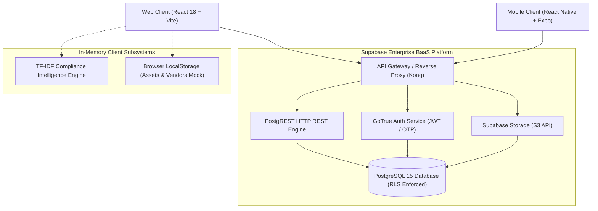

# AEGIS GRC — Backend Technology Stack & Architecture Inventory

**Document Type:** System Architecture & Backend Discovery Report  
**Target System:** AEGIS GRC Enterprise Platform  
**Target Environment:** Academic Assessment & Enterprise SaaS Audit  
**Audit Scope:** Server-side Data Architecture, PostgREST APIs, GoTrue Identity Service, Storage Engine, Database Schema, and Local Intelligence Engines  
**Generated On:** 2026-11-06  
**Auditor:** Senior Application Security & DevSecOps Engineering Team  

---

## 1. Automated Technology Stack Detection

Through deep static codebase inspection of configuration files (`package.json`, `.env.example`), data access abstractions (`src/services/api.ts`, `src/lib/supabase.ts`), authentication hooks (`src/hooks/useAuth.tsx`), and role definitions (`src/lib/permissions.ts`, `src/lib/types.ts`), the backend architecture is classified as follows:

| Dimension | Detected Technology / Specification | Architectural Role |
| :--- | :--- | :--- |
| **Backend Paradigm** | Backend-as-a-Service (BaaS) / Serverless Database Layer | Decoupled cloud data layer powering web and mobile enterprise clients |
| **Primary Platform** | **Supabase** (v2.118.0 client driver) | Unified Auth, PostgREST API gateway, Storage, and Realtime engine |
| **Database Engine** | **PostgreSQL 15+** | Relational data persistence, schema constraints, stored procedures, RLS |
| **Data API Gateway** | **PostgREST 12** | Automatic RESTful HTTP endpoints mapping directly to PostgreSQL tables/views |
| **Runtime Environment** | Node.js 20 LTS (V8 Engine) & Browser JS | Execution environment for client APIs, CLI scripts, and build pipelines |
| **Language & Typing** | TypeScript 5.6.3 / ECMAScript 2022 | Strict type enforcement for API contracts, query models, and RBAC matrix |
| **Package Management** | npm v10+ (lockfile v3) | Dependency orchestration, automated security audits, build scripting |
| **Storage Engine** | Supabase Storage (S3-compatible Object Store) | Secure multi-tenant binary document and artifact storage |
| **Identity & Auth** | Supabase GoTrue Auth Service | RFC 7519 JWT tokens, asymmetric verification, OAuth2, and OTP/Magic links |
| **Client Query Cache** | TanStack React Query v5.104.4 | Asynchronous state management, query invalidation, and data hydration |
| **Local Intelligence** | Embedded Heuristic TF-IDF Vector Engine | In-memory compliance knowledge ranking without external LLM API dependency |

---

## 2. Architectural Pattern



### Architectural Classification:
- **Style:** Multi-tenant Decoupled Architecture / Backend-as-a-Service (BaaS).
- **Communication Pattern:** Synchronous RESTful JSON over HTTPS via PostgREST; asynchronous signed URL downloads for binary evidence; local in-memory NLP vector search.
- **Tenant Isolation:** Logical multi-tenancy enforced at the database layer via `organization_id` foreign keys and PostgreSQL Row-Level Security (RLS) policies.

---

## 3. Database Schema & Data Models

The system maintains 16 primary relational entities in PostgreSQL:

| Table / Entity | Schema Role | Primary Keys & Foreign Relations | Cardinality & Scope |
| :--- | :--- | :--- | :--- |
| `profiles` | User identity metadata | `id` (PK, FK to `auth.users`), `email`, `full_name`, `job_title`, `avatar_url` | 1:1 with Auth User |
| `organizations` | Tenant organization boundary | `id` (PK, UUID), `name`, `slug`, `logo_url`, `settings` | 1:N with Memberships |
| `organization_memberships` | RBAC mapping & tenant linkage | `id` (PK), `organization_id` (FK), `user_id` (FK), `role`, `status` | N:M User to Org |
| `invitations` | Pending team invites & tokens | `id` (PK), `organization_id` (FK), `email`, `role`, `token`, `invited_by` | Org scoped |
| `frameworks` | Compliance standards catalog | `id` (PK), `name`, `slug`, `version`, `category`, `description` | Global / Org custom |
| `framework_controls` | Granular regulatory control specs | `id` (PK), `framework_id` (FK), `control_id`, `title`, `guidance` | 1:N with Framework |
| `compliance_assessments` | Org control audit status & score | `id` (PK), `organization_id` (FK), `control_id` (FK), `status`, `owner_id` | Org scoped |
| `risks` | Enterprise risk register | `id` (PK), `organization_id` (FK), `title`, `likelihood`, `impact`, `severity` | Org scoped |
| `risk_history` | Audit trail for risk changes | `id` (PK), `risk_id` (FK), `changed_by` (FK), `field_changed`, `old_value` | Immutable trail |
| `tasks` | Remediation work items | `id` (PK), `organization_id` (FK), `title`, `assigned_to` (FK), `priority`, `status`| Org scoped |
| `task_comments` | Discussion & collaboration notes | `id` (PK), `task_id` (FK), `user_id` (FK), `comment` | Task scoped |
| `evidence` | Uploaded audit artifacts | `id` (PK), `organization_id` (FK), `title`, `file_path`, `mime_type`, `file_size`| Org scoped |
| `evidence_control_links` | Cross-mapping artifacts to controls | `id` (PK), `evidence_id` (FK), `control_assessment_id` (FK) | N:M Evidence to Control |
| `notifications` | User alerts & system events | `id` (PK), `user_id` (FK), `organization_id` (FK), `title`, `is_read` | User scoped |
| `activity_logs` | Platform audit events | `id` (PK), `organization_id` (FK), `actor_id` (FK), `action`, `details` | Org audit trail |
| `assets` / `vendors` | Client-mocked inventory | In-memory / Browser `localStorage` cache (`aegis-assets-v1`, `aegis-vendors-v1`)| Client isolated |

---

## 4. Authentication Mechanism

1. **Token Standard:** JSON Web Tokens (JWT) adhering to RFC 7519.
2. **Signature Algorithm:** Asymmetric RSA256 or Symmetric HMAC-SHA256 (`supabase_anon_key` / `service_role_key`).
3. **Session Lifecycle:**
   - **Access Token:** Short-lived (typically 3600s / 1 hour), containing user claims: `sub` (UUID), `role` (`authenticated`), `email`, and custom tenant metadata.
   - **Refresh Token:** Long-lived opaque token stored securely by the client SDK with automatic renewal rotation via `autoRefreshToken: true`.
4. **Recovery & Verification:**
   - Email-based Magic Links & 6-digit OTP codes.
   - Recovery flow handled via `supabase.auth.onAuthStateChange` listening for `PASSWORD_RECOVERY` events and hash fragment token parsing (`#access_token=...&type=recovery`).

---

## 5. Authorization & Multi-Tenancy Architecture

The application enforces a dual-tier authorization model:

```
[Incoming Request]
        │
        ▼
[Tier 1: Client Application Guards]
(src/lib/permissions.ts: canActivateFramework, canCreateRisk, canDeleteEvidence)
        │
        ▼ (Network Request with Bearer JWT)
[Tier 2: PostgreSQL Row-Level Security (RLS)]
(auth.uid() = user_id AND organization_id IN (SELECT organization_id FROM organization_memberships WHERE user_id = auth.uid()))
```

### Detected Roles Matrix:
1. `super_admin`: Global platform configuration and cross-tenant maintenance.
2. `org_admin`: Full administrative domain control over organization members, frameworks, and policies.
3. `grc_analyst`: Operational management of frameworks, controls, risk assessments, and reports.
4. `it_security`: Remediation owner, task assignee, and technical evidence submission.
5. `auditor`: Read-only compliance auditor with access to controls, evidence, and activity logs.
6. `management`: Executive view with dashboard and reporting visibility.
7. `staff`: End-user task assignee and evidence uploader.

---

## 6. Storage & External Integrations

1. **Object Storage Engine:**
   - **Bucket `evidence` (Private):** Stores sensitive audit files, compliance documentation, and system screenshots. Direct public access is disabled; downloads require pre-signed URLs generated with a 60-second time-to-live (`createSignedUrl(path, 60)`).
   - **Bucket `avatars` (Public):** Stores user profile photos with deterministic paths `${userId}/avatar.${ext}`.
2. **Stored Procedures / Remote Procedure Calls (RPC):**
   - `accept_invitation(invite_token)`: Atomic database function validating token expiration, creating membership records, and invalidating tokens.
3. **External Hosting Integrations:**
   - Frontend: Vercel CDN / GitHub Pages.
   - Backend Cloud: Supabase Managed Cloud (AWS eu-west-1 / ap-south-1).
